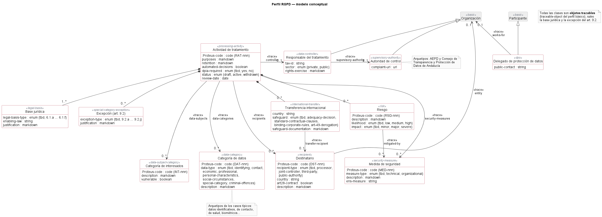

# Perfil RGPD para PROTEUS

Perfil de [PROTEUS](https://github.com/proteus-University-of-Seville/proteus-core) para elaborar
el **registro de actividades de tratamiento** (RAT, art. 30 RGPD). Está basado en el perfil
básico de PROTEUS y solo está en español.

## Contenido

- **Arquetipos de proyecto**, cada uno con un documento «Registro de actividades de
  tratamiento» que también puede añadirse a un proyecto existente:
  - *Plantilla para RAT*: las secciones del responsable, las actividades de tratamiento y
    los catálogos, cada una con un comentario que explica su contenido; el responsable y el
    delegado de protección de datos por completar; la Agencia Española de Protección de
    Datos como autoridad de control, y los elementos de catálogo que tiene casi cualquier
    organización (empleados, datos identificativos y de contacto, Agencia Tributaria,
    Seguridad Social y medidas de seguridad básicas).
  - *Ejemplo de RAT*: el registro de una empresa ficticia, Innova Consultores, S.L., con
    tres actividades (nóminas, videovigilancia y boletín comercial), sus catálogos y una
    consultora externa que presta el servicio de delegado de protección de datos.
- **Pestañas «General» y «Referencias»**: los arquetipos del perfil básico (secciones,
  párrafos, figuras, organizaciones, participantes, reuniones, matrices de trazabilidad,
  glosario, bibliografía y enlaces simbólicos).
- **Pestaña «Tratamientos»**: actividad de tratamiento, responsable del tratamiento, delegado
  de protección de datos y autoridad de control (AEPD y Consejo de Transparencia y
  Protección de Datos de Andalucía). Desde el menú contextual de una actividad se añaden sus
  bases jurídicas (art. 6.1), excepciones para categorías especiales de datos (art. 9.2),
  transferencias internacionales y riesgos.
- **Pestaña «Catálogos»**: categorías de interesados, categorías de datos, destinatarios y
  medidas de seguridad, que las actividades referencian mediante trazas. Las tres primeras
  tienen arquetipos de los casos típicos (empleados, datos de salud, Agencia Tributaria...).
- **Vistas**:
  - *Registro de actividades*: el registro completo, con riesgos y evaluación.
  - *Inventario público*: las actividades vigentes, con la información que el sector público
    debe publicar (art. 31.2 LOPDGDD).
  - *Cláusulas informativas*: la información básica a los interesados de cada actividad
    vigente (arts. 13 y 14 RGPD).

## Modelo conceptual

Clases que añade el perfil, con sus propiedades, sus objetos hijos y sus trazas (las clases
del perfil básico solo aparecen como referencia):



El diagrama se genera con [PlantUML](https://plantuml.com) a partir de
`conceptual-model/modelo-conceptual.puml`. Después de modificar este archivo, regenere
`conceptual-model/modelo-conceptual.png` de una de estas formas.

### Con PlantUML instalado en local

PlantUML necesita Java; para los diagramas de clases también se recomienda
[Graphviz](https://graphviz.org). Formas de instalarlo:

| Sistema | Instalación |
|---|---|
| Windows | `choco install plantuml` con [Chocolatey](https://chocolatey.org) (instala también Java y Graphviz) |
| macOS | `brew install plantuml` con [Homebrew](https://brew.sh) |
| Linux (Debian/Ubuntu) | `sudo apt install plantuml` (la versión de la distribución puede ser antigua) |
| Cualquiera | Descargar `plantuml.jar` de <https://plantuml.com/download> y ejecutarlo con `java -jar plantuml.jar` |

Desde la raíz del perfil (PlantUML deja la imagen junto al archivo `.puml`, en
`conceptual-model`):

```bash
plantuml -charset UTF-8 -tpng conceptual-model/modelo-conceptual.puml
```

o, con el archivo `plantuml.jar`:

```bash
java -jar plantuml.jar -charset UTF-8 -tpng conceptual-model/modelo-conceptual.puml
```

También puede usarse la extensión
[PlantUML](https://marketplace.visualstudio.com/items?itemName=jebbs.plantuml) de Visual
Studio Code, que muestra una vista previa del diagrama mientras se edita (`Alt+D`) y lo
exporta a PNG con la orden *PlantUML: Export Current Diagram*. Por defecto, la extensión
guarda la imagen en una carpeta `out`: muévala a `conceptual-model`.

### En la web, sin instalar nada

1. Abra el servidor en línea de PlantUML: <https://www.plantuml.com/plantuml>.
2. Sustituya el texto de ejemplo por el contenido completo de
   `conceptual-model/modelo-conceptual.puml` y pulse *Submit*.
3. Pulse el enlace *PNG* que aparece debajo del botón: abre la imagen en el navegador.
   Guárdela (botón derecho → *Guardar imagen como…*) como `modelo-conceptual.png` en la
   carpeta `conceptual-model` del perfil.

El servidor en línea es público: el diagrama solo contiene el modelo del perfil, pero no lo
use con diagramas que incluyan información confidencial.

## Uso

El perfil se selecciona de cualquiera de estas dos formas:

- **Desde PROTEUS**: pulse el botón *Configuración* de la pestaña *Inicio* (grupo
  *Aplicación*). En el grupo *Perfil* del diálogo, marque *Marque para usar un perfil
  personalizado*, seleccione la carpeta del perfil (por ejemplo, `C:\proteus-profiles\rgpd`)
  y pulse *Aceptar*.
- **Editando el archivo `proteus.ini`** de PROTEUS, con la aplicación cerrada:

  ```ini
  using_default_profile = False
  custom_profile_path = C:/proteus-profiles/rgpd
  ```

PROTEUS carga el perfil al arrancar, así que, en ambos casos, reinícielo y cree un proyecto a
partir del arquetipo «Plantilla para RAT» (o «Ejemplo de RAT», para ver un registro completo).

## Aviso

El perfil es un ejemplo de cómo estructurar un RAT con PROTEUS. Su contenido jurídico
(textos de ayuda, bases jurídicas, cláusulas) debe validarlo el delegado de protección de
datos de cada organización.
